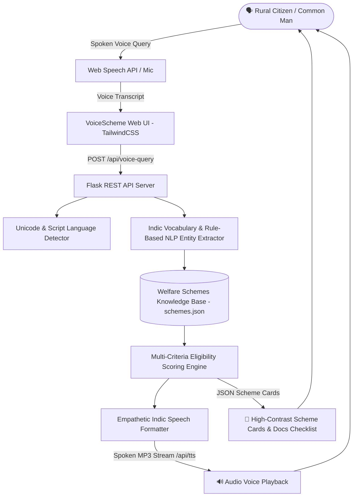

# 🎙️ VoiceScheme: Multilingual Voice Welfare Discovery for Bharat

> **Scaler x Wispr Flow Hackathon ("India Runs on Voice" / "Build for Bharat")**  
> **Theme:** Public Infrastructure & Civic Welfare Services  
> **Author / Contributor:** Roopa Sree ([@Roopasree-3101](https://github.com/Roopasree-3101))  
> **Repository:** [Doom-VoiceScheme](https://github.com/Roopasree-3101/Doom-VoiceScheme)

---

## 📌 Problem Statement

Over **300 million citizens** across rural and peri-urban India—marginal farmers, daily-wage laborers, elderly widows, and illiterate artisans—are legally entitled to life-changing Central and State government welfare schemes (PM-Kisan, Ayushman Bharat, PM Vishwakarma, Old-Age & Widow Pensions). 

Yet, billions of rupees in Direct Benefit Transfers (DBT) remain unclaimed every year because:
1. **Digital Illiteracy & Complex Portals:** Portals like *myscheme.gov.in* rely heavily on text filters, drop-downs, and bureaucratic English/formal Hindi forms.
2. **Exploitative Middlemen:** Citizens frequently lose 10%–20% of their benefits paying informal intermediaries simply to find out which schemes they qualify for.
3. **Language Barriers:** Existing portals lack conversational Indic voice processing for colloquial village dialects.

---

## 💡 The Solution: VoiceScheme

**VoiceScheme** is a voice-first, conversational web assistant enabling any citizen to simply **tap a microphone and speak in their everyday native language** (Hindi, Telugu, Tamil, or Indian English). 

The assistant listens to the citizen's personal situation (*e.g., "I have 2 acres of land and rain damaged my crops"*, or *"मेरे पति का देहांत हो गया है, बच्चे छोटे हैं और कच्चा मकान है"*), extracts eligibility entities via an offline Indic NLP engine, matches them against national databases, and **speaks back the top eligible schemes along with an actionable document checklist** in audio and visual cards.

---

## 🚀 Key Highlights & Hackathon Compliance

- ✅ **Zero Secret Keys Required:** Starts and runs 100% out of the box without requiring OpenAI, Google Cloud, or third-party paid API keys.
- ✅ **One-Command Docker Setup:** Fully containerized with `docker-compose.yml`. Judges can run `docker compose up` and launch immediately.
- ✅ **300+ Lines of Custom Code:** Built from scratch during Round 2 with Flask backend, multilingual regex entity extractor, and audio synthesis pipelines.
- ✅ **Real-world Verified Welfare Data:** Preloaded with 12+ verified Central & State schemes sourced directly from official portals (`myscheme.gov.in`, `data.gov.in`).
- ✅ **Multilingual Voice Playback:** Native audio responses using gTTS and Web Speech API synthesis for illiterate users who cannot read cards.

---

## 🏛️ System Architecture



---

## ⚡ Quickstart Guide

### Option 1: Run with Docker Compose (Recommended for Judges)

Ensure Docker is installed, then run:

```bash
# Clone the repository
git clone https://github.com/Roopasree-3101/Doom-VoiceScheme.git
cd Doom-VoiceScheme

# Start container with one command
docker compose up
```

Once started, open your web browser at:
👉 **`http://localhost:5000`**

---

### Option 2: Run Locally with Python

```bash
# Navigate to project folder
cd Doom-VoiceScheme

# Install dependencies
pip install -r requirements.txt

# Run the Flask app
python app.py
```

App runs at: **`http://127.0.0.1:5000`**

---

## 🧪 Evaluation Sample Scenarios (One-Click Demo)

The web UI includes pre-built one-click test scenarios for instant evaluation:

| Persona | Language | Sample Spoken Input | Top Matched Scheme |
|---|---|---|---|
| **Marginal Farmer** | English | *"I am a small farmer with 2 acres land, rain damaged my paddy crops. What schemes can help me?"* | **PM Fasal Bima Yojana** & **PM-Kisan** (₹6,000/yr + crop insurance) |
| **Destitute Widow** | Hindi (हिंदी) | *"मेरे पति का देहांत हो गया है, मेरे दो छोटे बच्चे हैं और घर कच्चा है।"* | **Indira Gandhi Widow Pension** & **PM Awas Yojana** |
| **Rural Artisan** | Telugu (తెలుగు) | *"నేను గ్రామీణ ప్రాంతంలో వడ్రంగి పని చేస్తాను. నాకు ఉపకరణాలు మరియు చిన్న వ్యాపార రుణం కావాలి."* | **PM Vishwakarma Scheme** (₹15,000 toolkits + 5% loan) |
| **BPL Student** | English | *"I am a college student from a low income BPL family. What scholarships can I apply for?"* | **Post-Matric Scholarship for EWS/OBC/SC/ST** |

---

## 📁 Modular Clean Architecture & Project Structure

VoiceScheme follows professional production software engineering principles with strict separation of concerns, the Flask Application Factory pattern, dedicated core service modules, and an automated test suite:

```text
Doom-VoiceScheme/
│
├── app.py                      # Application Factory & WSGI bootstrap entrypoint
├── requirements.txt            # Minimal Python dependencies (Flask, gTTS, etc.)
├── Dockerfile                  # Container definition with healthcheck probe
├── docker-compose.yml          # One-command compose deployment for judges
├── README.md                   # Project documentation & architecture
├── pitch_deck_content.md       # Complete pitch deck text for PDF generation
├── demo_video_script.md        # 2.5-minute YouTube video recording script
│
├── core/                       # Core Business & NLP Services
│   ├── __init__.py
│   ├── language_detector.py    # Unicode script & Indic language detector (Devanagari, Telugu, Tamil)
│   ├── nlp_engine.py           # Indic vocabulary & deterministic entity extractor
│   ├── matching_engine.py      # Multi-criteria scoring, ranking & spoken speech reply generator
│   └── tts_service.py          # Regional TTS synthesis with graceful degradation fallbacks
│
├── routes/                     # Modular Flask Blueprints
│   ├── __init__.py
│   ├── api.py                  # REST API endpoints (/api/voice-query, /api/schemes, /api/tts, /api/health)
│   └── web.py                  # Web frontend rendering routes (/)
│
├── tests/                      # Automated Unit & Integration Test Suite (10 Tests)
│   ├── __init__.py
│   ├── test_core.py            # Unit tests for NLP, language detection & matching algorithms
│   └── test_api.py             # Integration tests for Flask endpoints & HTTP contracts
│
├── data/
│   └── schemes.json            # 12+ detailed verified government welfare schemes
│
├── templates/
│   └── index.html              # Mobile-first voice interface with Tailwind CSS
│
└── static/
    ├── css/
    │   └── style.css           # Pulsing mic glow, audio bars & custom Indic fonts
    └── js/
        └── app.js              # Web Speech API recognition, dynamic card rendering, TTS
```

---

## 🧪 Automated Testing

Evaluators can verify the entire test suite (10 unit & integration tests) in under 100ms:

```bash
python -m unittest discover -s tests -t . -v
```

---

## 🛡️ License

MIT License. Developed for the Scaler x Wispr Flow Hackathon 2026.
